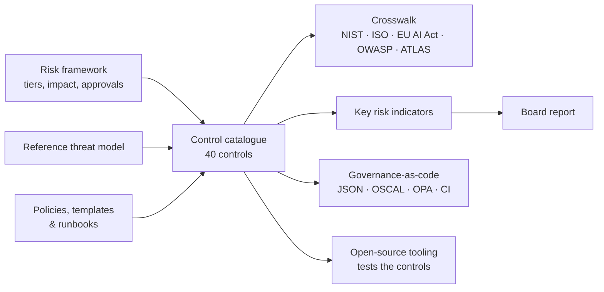

# AI Security Governance

[](https://github.com/thenayanhazra/ai-security-governance/actions/workflows/validate.yml)
[](LICENSE)

**A working governance kit for AI systems that take actions: risk framework, control catalogue, board reporting, threat model and supply-chain policy, mapped to the standards regulators and auditors use.**

Most AI governance material was written for systems that answer questions. Agents are different: they hold credentials, call tools and act on what they read. This kit governs them by what they are allowed to do, gives leadership numbers to steer by, and maps every control to NIST AI RMF, ISO/IEC 42001, the EU AI Act, the OWASP Top 10 lists for LLM and agentic applications, and MITRE ATLAS.

## Why it matters

- **Agents turn content into actions.** A support ticket, a web page or a tool description can now carry instructions that move money or export data. Governance has to follow authority, not just models.
- **Boards are being asked to oversee AI risk without a way to measure it.** The kit gives them thirteen indicators, a two-page quarterly report and a clear route for who approves what.
- **Regulation and standards moved in 2026.** The EU AI Act was amended, OWASP republished its LLM Top 10 and MITRE renumbered parts of ATLAS. Every mapping here is current and checked automatically against the source.

## What is inside

| For | Start with | What it gives you |
|---|---|---|
| Executives and risk owners | [AI and Agent Risk Framework](framework/ai-agent-risk-framework.md) and [Enterprise AI Policy](policies/enterprise-ai-policy.md) | Principles, autonomy tiers, impact ratings, approval routes, data-use matrix, SaaS/coding-agent rules and prohibited uses |
| Security and audit teams | [Control catalogue](framework/control-catalogue.md) | 40 controls in 10 domains, each with requirement, evidence, tier and impact trigger |
| Compliance | [Crosswalk](crosswalk/crosswalk.md) ([CSV](crosswalk/crosswalk.csv)) | Every control mapped to six frameworks, plus a reverse view showing mapped vs unmapped gaps |
| The board | [Board report template](board/ai-risk-board-report-template.md) and [worked example](board/example-board-report-q3-2026.md) | A five-minute quarterly report built on [thirteen key risk indicators](board/kri-library.md) |
| Architects and engineers | [Reference threat model for agentic AI](threat-models/agentic-ai-reference-threat-model.md) | Architecture, trust boundaries and 20 threats, each mapped to OWASP, ATLAS, controls and a test |
| Platform and procurement | [MCP server and agent component policy](policies/mcp-and-agent-supply-chain-policy.md) and [vendor contract checklist](templates/vendor-contract-checklist.md) | Ready-to-adopt policy for MCP servers, skills and instruction files, plus provider due-diligence clauses |
| Governance operations | [AI inventory](templates/ai-inventory-guide.md) ([CSV](templates/ai-inventory-template.csv)), [RACI & forum charter](templates/raci-and-forum-charter.md), [gate checklists](templates/lifecycle-gate-checklists.md) and [exception register](templates/exception-register-template.md) | Day-one working templates for every lifecycle gate, approval body, exception and decommissioning |
| Incident response & SRE | [Kill-switch runbook](runbooks/agent-kill-switch-runbook.md) and [AI incident response playbooks](runbooks/ai-incident-response-playbooks.md) | Emergency halt and revocation procedure (with `KRI-05` drill log), four AI incident playbooks and EU AI Act Art. 73 timelines |
| Platform & DevSecOps | [OPA reference policy](examples/opa/README.md), [MCP fingerprinting CLI](examples/mcp-fingerprint/README.md) and [CI gate workflow](examples/ci/ai-governance-gate.yml) | Runnable policy-as-code, `SUP-02` rug-pull detection and PR evidence automation |
| Programme leads | [30/60/90-day adoption playbook](docs/adoption-playbook.md) and [interactive control selector](docs/control-selector.html) | Rollout plan, 4-level maturity rubric and browser filter for applicable controls by tier, impact and framework |
| Tooling & GRC integration | [`dist/governance.json`](dist/governance.json), [`dist/oscal-catalog.json`](dist/oscal-catalog.json) and [JSON Schemas](schemas/controls.schema.json) | Versioned machine-readable bundle, NIST OSCAL 1.1.2 catalog and Draft 2020-12 schemas |
| Everyone | [Regulatory and standards horizon](regulatory/horizon.md) | The versions mapped and the dates that matter, as of November 2026 |

## How it fits together



The controls point to four open-source tools that produce evidence for them:

| Tool | Tests |
|---|---|
| [AI Threat Modelling Engine](https://github.com/thenayanhazra/ai-threat-modelling-engine) | Pre-release threat modelling and architecture/infrastructure controls (INV-03, SUP-02, IAM-01, IAM-02, ACT-03, ACT-04, ACT-06, DAT-01, OPS-01) |
| [MCP Adversarial Harness](https://github.com/thenayanhazra/mcp-adversarial-harness) | Supply-chain intake, confused deputy, indirect injection, policy enforcement, exfiltration and adversarial testing (SUP-01, IAM-02, INP-01, ACT-02, ACT-04, DAT-02, TST-01, HUM-02) |
| [agentlint](https://github.com/thenayanhazra/agentlint) | Instruction-file scanning, coding-agent rules, unpinned components, excess authority, secrets in agent context and exfiltration sinks (GOV-05, SUP-01, SUP-02, IAM-02, IAM-03, INP-01, INP-02, ACT-02, ACT-04) |
| [LLM Prompt Injection Fuzzer](https://github.com/thenayanhazra/llm-prompt-injection-fuzzer) | Prompt injection, prompt extraction, context manipulation and regression testing with bypass rates (INP-01, INP-04, ACT-05, TST-01, TST-02, KRI-04) |

[AI Security Assessment](https://github.com/thenayanhazra/ai-security-assessment) runs all four against one target and reports the results against these controls, with ratings based on the key risk indicators.

## How the mappings stay accurate

Framework mappings go stale quietly, and a wrong citation in front of an auditor is worse than none. So controls, KRIs and threats live in structured YAML under `data/` ([`controls.yaml`](data/controls.yaml), [`kris.yaml`](data/kris.yaml), [`threats.yaml`](data/threats.yaml)), validated against [JSON Schemas](schemas/controls.schema.json), and every Markdown catalogue, crosswalk, JSON bundle, OSCAL catalog and HTML selector is generated from them.

- [`tools/validate.py`](tools/validate.py) rejects any NIST, ISO, EU AI Act, OWASP or MITRE ATLAS identifier that is not in the [reference list](data/references.yaml) for the version in use.
- Every MITRE ATLAS ID, in the data and in the prose, is checked against [MITRE's published data](https://github.com/mitre-atlas/atlas-data). CI warns when MITRE releases a new version.
- Every control, KRI and threat ID cited in prose, and every relative link and heading anchor in the repository, must resolve.
- [`tools/build.py --check`](tools/build.py) fails if any generated file has been edited by hand.

```bash
pip install -e ".[dev]"
python tools/build.py      # regenerate docs, crosswalks, JSON, OSCAL and selector UI
python tools/validate.py   # check every mapping, reference, ATLAS ID and anchor
pytest -q                  # run unit tests
```

## Adapting it

Fork it and change it. Start with the [30/60/90-day adoption playbook](docs/adoption-playbook.md), calibrate the [KRI thresholds](data/kris.yaml) to your risk appetite, replace the roles in the [RACI and forum charter](templates/raci-and-forum-charter.md) with your own committee structure, and add controls in [`data/controls.yaml`](data/controls.yaml). The validator will tell you if a new mapping does not exist. See [CONTRIBUTING.md](CONTRIBUTING.md) for the workflow and [CHANGELOG.md](CHANGELOG.md) for releases.

What it is not: legal advice, a certification scheme, or a substitute for judging your own systems. It is a starting point that a security and risk function can adopt in weeks rather than build over quarters.

## License

Content is licensed under [CC BY 4.0](LICENSE): use and adapt it, with attribution. Framework names and identifiers belong to their publishers. ISO/IEC 42001 control titles are paraphrased; consult the published standard for normative text.
