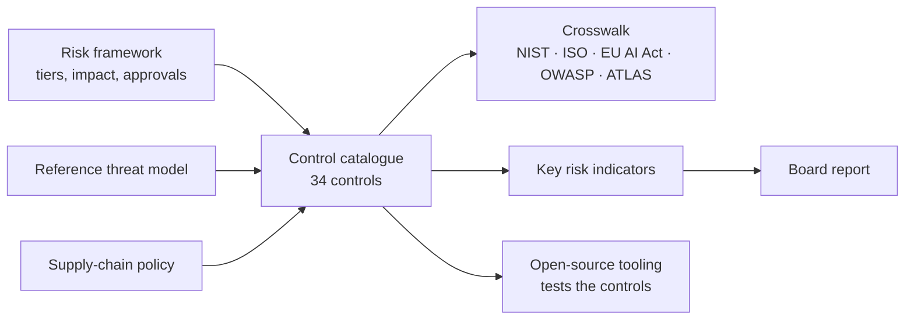

# AI Security Governance

[](https://github.com/thenayanhazra/ai-security-governance/actions/workflows/validate.yml)
[](LICENSE)

**A working governance kit for AI systems that take actions: risk framework, control catalogue, board reporting, threat model and supply-chain policy, mapped to the standards regulators and auditors use.**

Most AI governance material was written for systems that answer questions. Agents are different: they hold credentials, call tools and act on what they read. This kit governs them by what they are allowed to do, gives leadership numbers to steer by, and maps every control to NIST AI RMF, ISO/IEC 42001, the EU AI Act, the OWASP Top 10 lists for LLM and agentic applications, and MITRE ATLAS.

## Why it matters

- **Agents turn content into actions.** A support ticket, a web page or a tool description can now carry instructions that move money or export data. Governance has to follow authority, not just models.
- **Boards are being asked to oversee AI risk without a way to measure it.** The kit gives them twelve indicators, a two-page quarterly report and a clear route for who approves what.
- **Regulation and standards moved in 2026.** The EU AI Act was amended, OWASP republished its LLM Top 10 and MITRE renumbered parts of ATLAS. Every mapping here is current and checked automatically against the source.

## What is inside

| For | Start with | What it gives you |
|---|---|---|
| Executives and risk owners | [AI and Agent Risk Framework](framework/ai-agent-risk-framework.md) | Principles, autonomy tiers, impact ratings, approval routes, lifecycle gates and roles |
| Security and audit teams | [Control catalogue](framework/control-catalogue.md) | 34 controls in 10 domains, each with requirement, evidence and tier |
| Compliance | [Crosswalk](crosswalk/crosswalk.md) ([CSV](crosswalk/crosswalk.csv)) | Every control mapped to six frameworks, plus a reverse view that shows gaps |
| The board | [Board report template](board/ai-risk-board-report-template.md) and [worked example](board/example-board-report-q3-2026.md) | A five-minute quarterly report built on [twelve key risk indicators](board/kri-library.md) |
| Architects and engineers | [Reference threat model for agentic AI](threat-models/agentic-ai-reference-threat-model.md) | Architecture, trust boundaries and 17 threats, each mapped to OWASP, ATLAS, controls and a test |
| Platform and procurement | [MCP server and agent component policy](policies/mcp-and-agent-supply-chain-policy.md) | Ready-to-adopt policy for MCP servers, skills and instruction files, aligned to the MCP specification |
| Everyone | [Regulatory and standards horizon](regulatory/horizon.md) | The versions mapped and the dates that matter, as of November 2026 |

## How it fits together



The controls point to four open-source tools that produce evidence for them:

| Tool | Tests |
|---|---|
| [AI Threat Modelling Engine](https://github.com/thenayanhazra/ai-threat-modelling-engine) | Threat and impact assessment before release (INV-03) |
| [MCP Adversarial Harness](https://github.com/thenayanhazra/mcp-adversarial-harness) | Supply-chain intake, policy enforcement, exfiltration and adversarial testing (SUP-01, ACT-02, ACT-04, TST-01) |
| [agentlint](https://github.com/thenayanhazra/skill-agent-file-linter) | Instruction-file scanning, secrets in agent context, exfiltration sinks (INP-02, IAM-03, ACT-04) |
| [LLM Prompt Injection Fuzzer](https://github.com/thenayanhazra/llm-prompt-injection-fuzzer) | Adversarial and regression testing with bypass rates (TST-01, TST-02, KRI-04) |

## How the mappings stay accurate

Framework mappings go stale quietly, and a wrong citation in front of an auditor is worse than none. So the controls live in one data file, [`data/controls.yaml`](data/controls.yaml), and everything else is generated from it.

- [`tools/validate.py`](tools/validate.py) rejects any NIST, ISO, EU AI Act or OWASP identifier that is not in the [reference list](data/references.yaml) for the version in use.
- Every MITRE ATLAS ID, in the data and in the prose, is checked against [MITRE's published data](https://github.com/mitre-atlas/atlas-data). CI warns when MITRE releases a new version.
- Every relative link in the repository must resolve.
- [`tools/build.py --check`](tools/build.py) fails if the catalogue or crosswalk has been edited by hand.

```bash
pip install pyyaml
python tools/build.py      # regenerate catalogue and crosswalk
python tools/validate.py   # check every mapping and link
```

## Adapting it

Fork it and change it. Calibrate the [KRI thresholds](board/kri-library.md) to your risk appetite, replace the roles in the framework with your own committee structure, and add controls in `data/controls.yaml`. The validator will tell you if a new mapping does not exist.

What it is not: legal advice, a certification scheme, or a substitute for judging your own systems. It is a starting point that a security and risk function can adopt in weeks rather than build over quarters.

## License

Content is licensed under [CC BY 4.0](LICENSE): use and adapt it, with attribution. Framework names and identifiers belong to their publishers. ISO/IEC 42001 control titles are paraphrased; consult the published standard for normative text.
