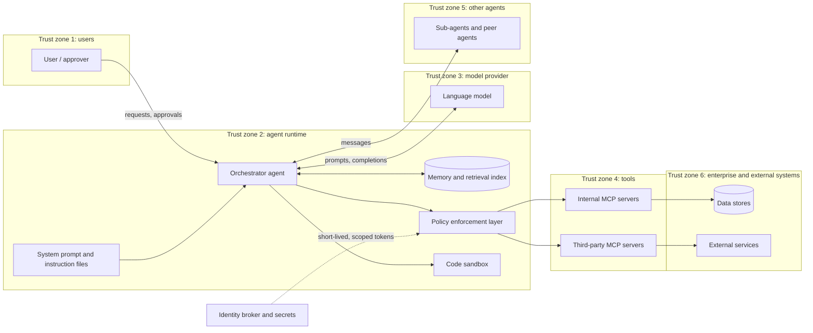

# Reference threat model: agentic AI systems

A starting point for threat modelling any system in which a model plans and takes actions through tools. It describes a typical architecture, the trust boundaries in it, and seventeen threats that recur across agent deployments. Each threat links to the [controls](../framework/control-catalogue.md) that address it and to a way of testing for it.

Use it as a baseline, not a finished model. Remove the components a system does not have, add the ones it does, and record the system-specific threats that this generic model cannot know about.

## Reference architecture

Every arrow that crosses a trust zone is a place where content can carry instructions or where authority can leak. The two that matter most are content flowing *into* the orchestrator from tools, memory and other agents, and actions flowing *out* through the policy layer.

## Components

| ID | Component | Why it matters |
|---|---|---|
| C1 | User and approver | Source of legitimate instructions, and the human check on consequential actions |
| C2 | Orchestrator agent | Decides what to do next; holds the agent's authority |
| C3 | System prompt and instruction files | Defines behaviour; includes skills, AGENTS.md, IDE rules and MCP configuration |
| C4 | Tools and MCP servers | Where the agent's actions take effect; tool descriptions and results are read by the model |
| C5 | Memory and retrieval index | Persists across sessions, so a poisoned entry keeps working |
| C6 | Sub-agents and peer agents | Can pass instructions and authority between agents |
| C7 | Identity broker and secrets | Issues the credentials the agent acts with |
| C8 | Code sandbox | Runs code the agent writes |
| C9 | Policy enforcement layer | Enforces limits the model cannot change |

## Threats

| ID | Threat | Component | Scenario | OWASP | MITRE ATLAS | Controls | How to test |
|---|---|---|---|---|---|---|---|
| T-01 | Direct prompt injection | C1, C2 | A user tells the agent to ignore its instructions and act outside its purpose. | LLM01, ASI01 | AML.T0051.000 | [INP-01](../framework/control-catalogue.md#inp-01), [ACT-02](../framework/control-catalogue.md#act-02) | Injection corpus against the production prompt ([fuzzer](https://github.com/thenayanhazra/llm-prompt-injection-fuzzer)) |
| T-02 | Indirect prompt injection | C2, C4, C5 | A document, web page or email the agent reads contains instructions that redirect it. | LLM01, ASI01 | AML.T0051.001 | [INP-01](../framework/control-catalogue.md#inp-01), [ACT-01](../framework/control-catalogue.md#act-01), [ACT-02](../framework/control-catalogue.md#act-02) | Indirect and tool-result probes ([fuzzer](https://github.com/thenayanhazra/llm-prompt-injection-fuzzer), [MCP harness](https://github.com/thenayanhazra/mcp-adversarial-harness)) |
| T-03 | Tool poisoning | C4 | An MCP server's tool description contains hidden instructions that the model follows whenever the tool is listed. | LLM04, ASI04 | AML.T0110.000 | [SUP-01](../framework/control-catalogue.md#sup-01), [SUP-02](../framework/control-catalogue.md#sup-02), [ACT-02](../framework/control-catalogue.md#act-02) | Description-injection probes ([MCP harness](https://github.com/thenayanhazra/mcp-adversarial-harness)) |
| T-04 | Tool rug pull | C4 | A server behaves well during review, then changes its tool definitions or behaviour once approved. | LLM04, ASI04 | AML.T0109 | [SUP-02](../framework/control-catalogue.md#sup-02) | Fingerprint tool definitions at approval; alert on any difference |
| T-05 | Malicious instruction file | C3 | A skill or rules file pulled from a marketplace or repository hides instructions in invisible Unicode or comments. | LLM01, ASI04 | AML.T0081 | [INP-02](../framework/control-catalogue.md#inp-02), [SUP-01](../framework/control-catalogue.md#sup-01) | Static scan in CI ([agentlint](https://github.com/thenayanhazra/skill-agent-file-linter)) |
| T-06 | Exfiltration through a tool call | C2, C4 | Injected instructions make the agent send data to an attacker using a legitimate tool such as HTTP or email. | LLM02, ASI02 | AML.T0086 | [ACT-04](../framework/control-catalogue.md#act-04), [ACT-01](../framework/control-catalogue.md#act-01), [ACT-02](../framework/control-catalogue.md#act-02) | Exfiltration probes ([MCP harness](https://github.com/thenayanhazra/mcp-adversarial-harness)) |
| T-07 | Exfiltration through rendered output | C1, C2 | The agent outputs a markdown image or link whose URL carries conversation data; the client fetches it automatically. | LLM02, LLM10 | AML.T0136 | [ACT-04](../framework/control-catalogue.md#act-04), [DAT-02](../framework/control-catalogue.md#dat-02) | Image-exfiltration payloads; scan instruction files for image sinks ([agentlint](https://github.com/thenayanhazra/skill-agent-file-linter) rule AGT040) |
| T-08 | Destructive action | C2, C4 | The agent deletes data or changes configuration because of an injected or misunderstood instruction. | LLM03, ASI02 | AML.T0101 | [ACT-01](../framework/control-catalogue.md#act-01), [ACT-02](../framework/control-catalogue.md#act-02), [OPS-02](../framework/control-catalogue.md#ops-02) | Probes that request destructive tools; confirm approval gates hold |
| T-09 | Credential theft | C3, C7 | Keys or tokens placed in configuration, prompts or tool descriptions are read out by the model or harvested through a tool. | LLM02, ASI03 | AML.T0083, AML.T0098 | [IAM-03](../framework/control-catalogue.md#iam-03), [IAM-02](../framework/control-catalogue.md#iam-02) | Scan configuration for secrets and sensitive paths ([agentlint](https://github.com/thenayanhazra/skill-agent-file-linter) rule AGT042) |
| T-10 | Confused deputy | C4, C7 | A server acts with its own broad credentials on behalf of a user who should not have that access, or passes a user token through to another service. | LLM03, ASI03 | — | [IAM-02](../framework/control-catalogue.md#iam-02) | Confused-deputy probes ([MCP harness](https://github.com/thenayanhazra/mcp-adversarial-harness)); review token audience settings |
| T-11 | Memory poisoning | C5 | An attacker gets an instruction written into long-term memory, where it influences later sessions and other users. | LLM05, ASI06 | AML.T0080.000 | [INP-03](../framework/control-catalogue.md#inp-03) | Attempt memory writes from untrusted content; check provenance tags |
| T-12 | Retrieval index poisoning | C5 | Planted documents in a retrieval index steer answers or carry indirect injections. | LLM09, ASI06 | AML.T0070 | [INP-03](../framework/control-catalogue.md#inp-03), [DAT-01](../framework/control-catalogue.md#dat-01) | Seed test documents; confirm they are excluded or labelled |
| T-13 | Sandbox escape | C8 | Code written by the agent breaks out of its sandbox or reaches credentials and networks it should not. | LLM10, ASI05 | AML.T0105 | [ACT-03](../framework/control-catalogue.md#act-03) | Escape and egress tests inside the sandbox |
| T-14 | Instructions spreading between agents | C6 | A compromised agent passes injected instructions or excess authority to other agents, which act on them. | ASI07, ASI08 | AML.T0118, AML.T0143 | [ACT-05](../framework/control-catalogue.md#act-05) | Inject at one agent; trace whether others act on it |
| T-15 | Runaway consumption | C2 | A loop or adversarial input makes the agent call tools or models without end, running up cost or exhausting a service. | LLM06, ASI08 | AML.T0034.002 | [ACT-06](../framework/control-catalogue.md#act-06), [OPS-02](../framework/control-catalogue.md#ops-02) | Load and loop tests against budgets |
| T-16 | Approval fatigue | C1 | Approvals are requested so often, or presented so vaguely, that reviewers approve without reading. | ASI09 | — | [HUM-02](../framework/control-catalogue.md#hum-02), [ACT-01](../framework/control-catalogue.md#act-01) | Measure approval time and rate; review approval screens |
| T-17 | Undetected goal drift | C2 | The agent gradually pursues something other than its assigned goal, and no one notices. | ASI10 | — | [OPS-04](../framework/control-catalogue.md#ops-04), [OPS-01](../framework/control-catalogue.md#ops-01), [OPS-02](../framework/control-catalogue.md#ops-02) | Compare actions against the agent's baseline and stated goal |

## Using this model

1. **Describe the system.** Draw its actual architecture using the components above. For infrastructure defined in code, the [AI Threat Modelling Engine](https://github.com/thenayanhazra/ai-threat-modelling-engine) produces a first-pass model and attack paths automatically.
2. **Classify it.** Assign an autonomy tier and impact rating using the [risk framework](../framework/ai-agent-risk-framework.md). The tier tells you which threats need controls before release.
3. **Walk each trust boundary.** For every arrow that crosses a zone, ask what content crosses it, whether that content can carry instructions, and what authority sits on the other side.
4. **Record what is different.** Add threats specific to the system's purpose and data. The generic list does not cover business-logic abuse.
5. **Test the important ones.** Every threat rated high should have a test, and the test should run again whenever tools, prompts or models change.

## Sources

- OWASP Top 10 for Agentic Applications, 2026 edition
- OWASP Top 10 for LLM Applications, 2026 edition
- MITRE ATLAS, v2026.10
- Model Context Protocol specification, version 2026-07-28, security best practices and authorization security considerations
